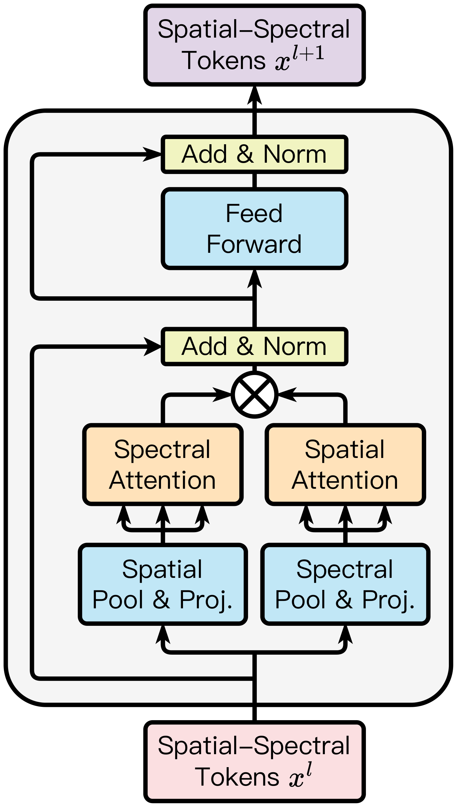

<div align="center">

<h1>LESSViT: Robust Hyperspectral Representation Learning under Spectral Configuration Shift</h1>

[](https://arxiv.org/abs/2605.18541)
[](https://uiuctml.github.io/LESSViT/)
[](https://huggingface.co/GFM-Bench/LESSViT-Base)
[](https://github.com/uiuctml/LESSViT)

</div>

This is the official repository for the paper
"_LESSViT: Robust Hyperspectral Representation Learning under Spectral Configuration Shift_".

Authors:
[Haozhe Si](https://ehzoahis.github.io/),
Yuxuan Wan,
Yuqing Wang,
[Minh Do](https://minhdo.ece.illinois.edu/),
[Han Zhao](https://hanzhaoml.github.io/).

## Overview

<div align="center">

</div>

Modeling hyperspectral imagery (HSI) across different sensors presents a fundamental challenge due to variations in wavelength coverage, band sampling, and channel dimensionality. We introduce **LESSViT** (**L**ow-rank **E**fficient **S**patial–**S**pectral **Vi**sion **T**ransformer), a sensor-flexible architecture for cross-spectral generalization.

Our contributions are:

1. **LESS Attention** — a structured low-rank factorization of spatial–spectral attention that reduces complexity from O(N²C²) to O(rNC), where N is the number of spatial tokens, C is the number of spectral channels, and r is the approximation rank.
2. **LESSViT** — a channel-agnostic ViT with wavelength-aware positional encoding (SSRoPE) that enables consistent modeling under varying spectral configurations.
3. **HyperMAE** — a hyperspectral masked autoencoder pre-training strategy with decoupled spatial–spectral masking and hierarchical channel sampling for scalable and robust learning.

## Pre-training

We pre-train LESSViT using **HyperMAE** on the [SpectralEarth](https://github.com/blumenstiel/SpectralEarth) benchmark (EnMAP hyperspectral data) for 200 epochs.

To launch pre-training, run:
```shell
bash launch_train.sh
```

See [`GeospatialFM/scripts/args.py`](GeospatialFM/scripts/args.py) for full argument descriptions.

## Evaluation: Cross-Spectral Generalization

We evaluate LESSViT under a cross-spectral generalization setting on the SpectralEarth benchmark. Models are pre-trained and fine-tuned on a fixed channel configuration (C120_VNIR+) and evaluated across four spectral settings:

| Setting | Description |
|---|---|
| `id` | In-distribution (C120_VNIR+) |
| `ood_a` | Spectral shift (C120_SWIR+) |
| `ood_complement` | Unseen wavelengths (C82, disjoint from training) |
| `ood_full` | Channel expansion (C202, all channels) |

Downstream datasets: `enmap_cdl`, `enmap_corine`, `enmap_eurocrops`, `enmap_bdforet`, `enmap_bnetd`.

To launch fine-tuning on a SpectralEarth dataset, run:
```shell
bash launch_finetune.sh
```
which wraps:
```shell
python3 GeospatialFM/finetune/finetune.py \
    --dataset_name ${DATASET_NAME} \
    --task_type ${TASK_TYPE} \
    --data_dir ${DATA_DIR} \
    --gen_task ${GEN_TASK} \
    --model_name ${MODEL_NAME} \
    --pretrained_model_path ${PRETRAINED_MODEL_PATH} \
    --run_name ${RUN_NAME} \
    --output_dir ${OUTPUT_DIR}
```

- `--dataset_name`: One of `enmap_cdl`, `enmap_corine`, `enmap_eurocrops`, `enmap_bdforet`, `enmap_bnetd`.
- `--gen_task`: One of `id`, `ood_a`, `ood_complement`, `ood_full`.
- `--model_name`: The backbone to fine-tune. `lessvit` (this work) or one of the supported baselines: `dofa`, `dinov3`, `specvit`, `spatsigma`, `channelvit`, `hyperfree` ([HyperFree](https://github.com/Jingtao-Li-CVer/HyperFree)).
- `--pretrained_model_path`: **A directory**, not a file — this convention is the same for every backbone. Each encoder's `load_pretrained_weights` globs for its own checkpoint file(s) inside the directory it's given (see `GeospatialFM/models/wrappers/`). By convention, checkpoints for a given backbone live under `results/models/<model_name>/`, the same tree that pre-training and fine-tuning runs save their own checkpoints to.

See [`GeospatialFM/finetune/args.py`](GeospatialFM/finetune/args.py) for full argument descriptions, and [`GeospatialFM/models/registry.py`](GeospatialFM/models/registry.py) for the full set of supported baseline encoders.

## Pretrained Checkpoint

**[LESSViT-Base on Hugging Face](https://huggingface.co/GFM-Bench/LESSViT-Base)**
provides the pretrained encoder, its configuration, standalone model code, and
[an executable loading example](https://huggingface.co/GFM-Bench/LESSViT-Base/blob/main/load_encoder.py).
The encoder has 83.2M parameters, 12 layers, a 768-dimensional embedding, 12 attention
heads, patch size 16, and rank-1 LESS Attention with spatial–spectral RoPE.

### Load the encoder directly

No repository checkout is required. Reference environment: Python 3.11.

```bash
pip install torch==2.7.1 torchvision==0.22.1 transformers==4.53.3 \
  huggingface-hub==0.34.4 timm==1.0.18 numpy==2.2.6 safetensors
```

```python
import torch
from transformers import AutoModel

encoder = AutoModel.from_pretrained(
    "GFM-Bench/LESSViT-Base",
    trust_remote_code=True,
).eval()

# Synthetic example; normalize real imagery with dataset-specific statistics.
x = torch.randn(1, 10, 32, 32)
wavelengths_nm = torch.linspace(450, 2300, 10)[None, :]
# Fixed full-EnMAP reference bounds for this example. Keep the same reference
# bounds across downstream training/evaluation; do not rescale each band subset.
wavelengths = (wavelengths_nm - 418.24) / (2445.53 - 418.24)

with torch.no_grad():
    features = encoder(
        optical=x,
        optical_channel_wv=wavelengths,
        spatial_resolution=30,
    ).last_hidden_state

print(features.shape)                   # [1, 11, 5, 768]
global_features = features[:, 0, 0]      # [1, 768]: classification
spatial_features = features[:, 0, 1:]    # [1, 4, 768]: dense prediction
```

Inputs have shape `[B, C, H, W]`, with spatial dimensions divisible by 16.
Wavelengths must follow the input channel order. Outputs have shape
`[B, C+1, N+1, 768]`, where `N = (H/16) * (W/16)`; index 0 contains aggregation
tokens. Task heads are not included and require downstream training. You can pin
`revision` to a Hugging Face commit SHA for reproducible loading.

The Hub root `model.safetensors` is the **encoder-only AutoModel export**.
The unchanged full MAE checkpoint is available under
[`pretraining/model.safetensors`](https://huggingface.co/GFM-Bench/LESSViT-Base/tree/main/pretraining),
with architectural metadata in `pretraining/architecture.json`. The original
checkpoint uses legacy `encoder.*` keys; the root export is not a drop-in file
for the repository's `load_pretrained_encoder` method. Use the AutoModel example
above for direct encoder loading.

### Intended use and limitations

**This checkpoint was pretrained on a partial subset of EnMAP data, not the
complete EnMAP corpus.** It is released primarily to investigate whether explicit,
efficient spatial–spectral modeling improves robustness to changes in band
sampling, channel count, and simulated sensor responses.

**This is not a fully optimized EnMAP foundation model or a guarantee of
universally superior downstream performance.** Results under the evaluated
protocols do not establish optimal performance on the full EnMAP dataset, unseen
geographic distributions, or arbitrary downstream tasks. Robustness to spectral
changes does not imply the highest accuracy under every fixed configuration.
Comparisons should account for pretraining coverage, training budget, spatial
resolution, and adaptation protocol. Independently validate this checkpoint for
your application; broader pretraining and task-specific adaptation may be needed.
No guarantee is made regarding accuracy, generalization, or fitness for operational use.

See the [full model card and limitations](https://huggingface.co/GFM-Bench/LESSViT-Base#intended-use-and-limitations).

## Citation

If you find our work helpful, please cite our paper:
```bibtex
@misc{si2026lessvitrobusthyperspectralrepresentation,
      title={LESSViT: Robust Hyperspectral Representation Learning under Spectral Configuration Shift}, 
      author={Haozhe Si and Yuxuan Wan and Yuqing Wang and Minh Do and Han Zhao},
      year={2026},
      eprint={2605.18541},
      archivePrefix={arXiv},
      primaryClass={cs.CV},
      url={https://arxiv.org/abs/2605.18541}, 
}
```

## Contact

[Haozhe Si](mailto:haozhes3@illinois.edu), [Han Zhao](mailto:hanzhao@illinois.edu)
